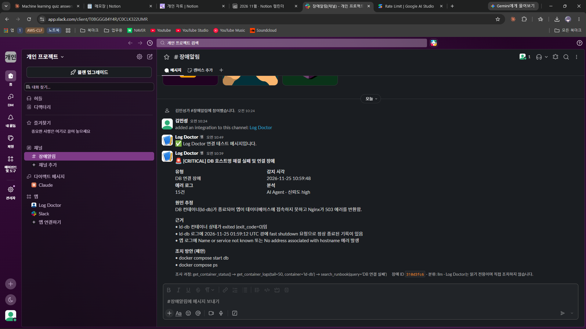
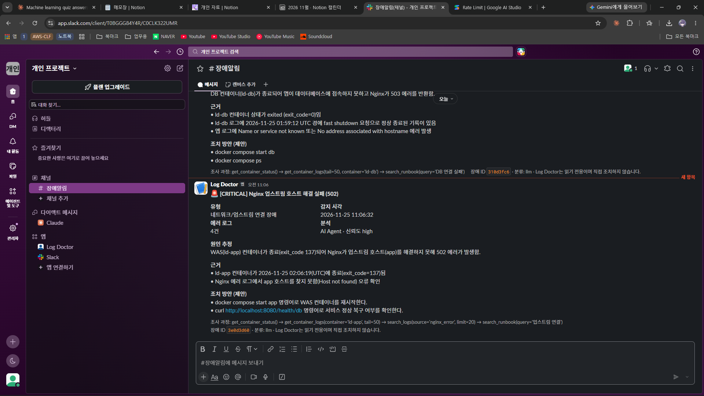
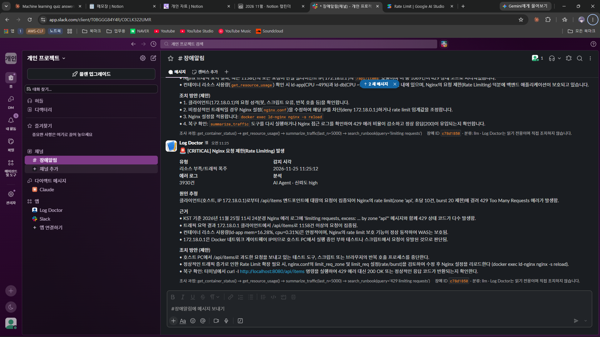
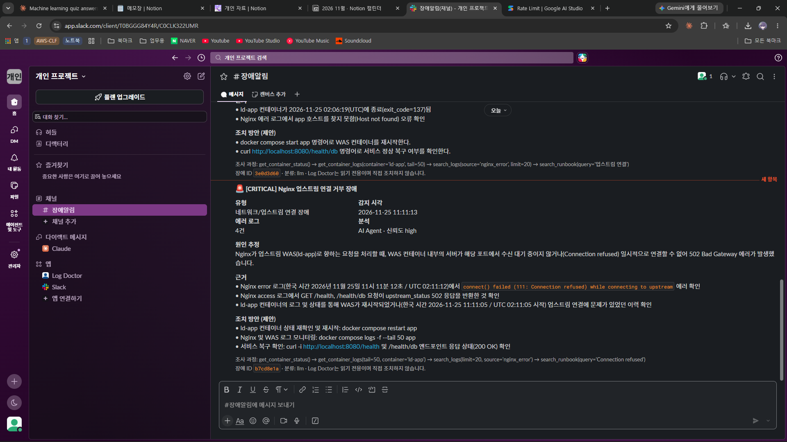
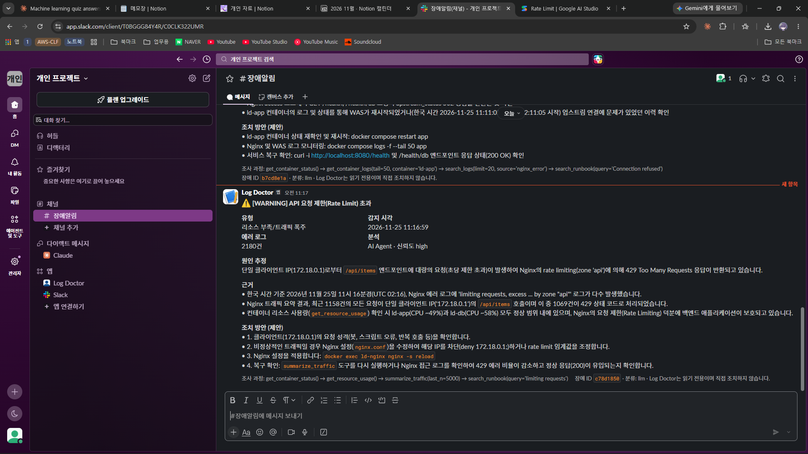

# Log Doctor — 서버 장애 로그 분석 Agent

> 서버 로그를 AI가 분석해 **장애 원인과 조치 방법을 Slack으로 알려주는** Workflow + AI Agent 하이브리드 시스템

대구대학교 Workflow / AI Agent 개발 과제 (개인 프로젝트, 마감 2026-12-04)

## 1. 프로젝트 소개

서버에 장애가 나면 담당자는 여러 로그 파일을 열어 보고, 컨테이너 상태를 확인하고, 조치 문서를 찾아야 합니다. Log Doctor는 이 과정을 자동화합니다.

| 단계 | 방식 | 하는 일 |
|---|---|---|
| ① 로그 수집 | Workflow (코드) | 30초마다 Nginx·WAS 로그에서 새로 추가된 줄만 읽음 |
| ② 에러 감지·묶기 | Workflow (코드) | 에러만 골라 "에러 지문"으로 묶고, 이미 알린 장애는 5분간 다시 알리지 않음 |
| ③ 유형 분류 | **Routing** (LLM) | DB 연결 / 네트워크 / 리소스·트래픽 / 권한 중 하나로 분류 |
| ④ 원인 조사 | **AI Agent** (Tool Calling) | 유형별로 허용된 도구 중 필요한 것을 LLM이 스스로 골라 조사 |
| ⑤ 보고 | Workflow (코드) | 원인·근거·조치 방안을 Slack으로 전송 |

**설계 원칙**
- **읽기 전용 Agent**: 로그·상태 조회 도구만 제공합니다. 재시작·삭제 같은 변경은 하지 않고 조치를 "제안"만 합니다.
- **LLM이 실패해도 동작**: API 키가 없거나 무료 한도를 넘으면 키워드 규칙과 고정 절차로 대체해 알림은 계속 보냅니다.
- **알림 폭탄 방지**: 같은 장애가 반복되면 묶어서 한 번만 알립니다. LLM 호출도 장애 1건당 3~5회로 제한됩니다.

## 2. 시스템 처리 흐름도

```mermaid
flowchart TD
    subgraph Target["분석 대상 3-Tier (Docker Compose)"]
        N[Nginx :8080] --> A[FastAPI WAS] --> D[(PostgreSQL)]
    end
    N -. access.log / error.log .-> L[(logs/)]
    A -. app.log .-> L

    L --> C["① 로그 수집<br/>새로 추가된 줄만 (30초 주기)"]
    C --> DET{"② 에러 감지<br/>5xx·429·ERROR"}
    DET -- 없음 / 이미 알린 장애 --> C
    DET -- 신규 장애 --> R{"③ LLM 유형 분류<br/>(Routing)"}

    R -- DB_CONNECTION --> T1[DB 조사 도구 세트]
    R -- NETWORK --> T2[업스트림 조사 도구 세트]
    R -- RESOURCE --> T3[트래픽·리소스 도구 세트]
    R -- PERMISSION / UNKNOWN --> T4[기타 도구 세트]

    T1 & T2 & T3 & T4 --> AG

    subgraph AG["④ AI Agent 루프 (최대 6회)"]
        TH[LLM: 다음 행동 결정] -- 도구 호출 --> TL[도구 실행<br/>로그 검색 · 컨테이너 상태 · 리소스 ·<br/>엔드포인트 점검 · 조치 문서 검색]
        TL -- 결과 --> TH
    end

    AG -- 최종 보고 JSON --> S["⑤ Slack 알림<br/>원인 · 근거 · 조치 방안"]
    R -. LLM 실패 .-> FB[규칙 기반 분류·고정 절차] --> S
```

### Agent가 쓸 수 있는 도구 (모두 읽기 전용)

| 도구 | 하는 일 | 사용 유형 |
|---|---|---|
| `search_logs` | 로그 파일 키워드 검색 | 전체 |
| `get_container_status` | 컨테이너 상태, 종료 코드, OOM 여부 | 전체 |
| `get_container_logs` | `docker logs`로 종료 직전 로그 확인 | DB, 네트워크, 권한 |
| `check_endpoint` | `/health`, `/health/db` 등 현재 응답 확인 | DB, 네트워크 |
| `get_resource_usage` | CPU·메모리 사용량 (`docker stats`) | 리소스 |
| `summarize_traffic` | 상태 코드 분포, 요청 많은 IP·URI | 리소스 |
| `search_runbook` | 조치 문서(`agent/runbooks/`) 검색 (간단한 RAG) | 전체 |

## 3. 사용 기술

| 영역 | 기술 | 비고 |
|---|---|---|
| 분석 대상 인프라 | Docker Compose, Nginx 1.27, FastAPI, PostgreSQL 16 | 무료, 로컬에서 장애 재현 |
| Agent | Python 3.11+ **표준 라이브러리만 사용** | `pip install` 없이 실행 |
| LLM | Google Gemini API (REST, Function Calling) | 무료 티어 Flash Lite(하루 500회), 503·429 시 예비 모델로 자동 전환 |
| 알림 | Slack Incoming Webhook (Block Kit 메시지) | 무료 |
| 적용한 개념 | Prompt Chaining, Routing, Tool Calling(Agent 루프), RAG(키워드 검색), Fallback | |

Agent 루프는 LangChain·LangGraph 같은 프레임워크 없이 직접 구현했습니다. "LLM 응답에 함수 호출이 있으면 도구를 실행하고 결과를 다시 넘기며, 없으면 최종 답으로 본다"는 Agent의 핵심 구조가 `agent/investigator.py`에 그대로 드러나도록 하기 위해서입니다.

## 4. 실행 방법

### 사전 준비
- Docker Desktop (Windows는 WSL2 기반 권장)
- Python 3.11 이상
- (선택) Gemini API 키: https://aistudio.google.com/apikey
- (선택) Slack Incoming Webhook URL: https://api.slack.com/apps → 앱 생성 → Incoming Webhooks 켜기 → 채널 선택

### 1) 3-Tier 환경 실행

```bash
git clone https://github.com/sorakaeri/log-doctor-agent.git
cd log-doctor-agent
cp .env.example .env              # Windows PowerShell: Copy-Item .env.example .env
# .env에 GEMINI_API_KEY, SLACK_WEBHOOK_URL 입력

docker compose up -d --build
python scripts/chaos.py status    # 세 경로 모두 200이면 정상
```

### 2) Agent 점검

```bash
python scripts/list_models.py     # 내 API 키로 쓸 수 있는 Gemini 모델 ID 확인
python -m agent --check           # 로그 파일, Gemini 연결 확인
python -m agent --test-slack      # Slack에 테스트 메시지 전송
```

### 3) Agent 실행 + 장애 발생

터미널 두 개를 엽니다.

```bash
# 터미널 1: Agent 감시 시작 (30초마다 확인)
python -m agent

# 터미널 2: 장애 발생 → 30초 안에 Slack 알림 확인 → 복구
python scripts/chaos.py db-down
python scripts/chaos.py recover
```

| 명령 | 시나리오 | 기대 분류 |
|---|---|---|
| `python scripts/chaos.py db-down` | DB 컨테이너 중지 → 앱 503 | DB 연결 장애 |
| `python scripts/chaos.py app-down` | WAS 컨테이너 중지 → Nginx 502 | 네트워크/업스트림 연결 장애 |
| `python scripts/chaos.py flood` | 요청 폭주 → Nginx 429 | 리소스 부족/트래픽 폭주 |
| `python scripts/chaos.py recover` | 전체 복구 | |

시나리오 사이에는 `recover` 후 다음 시나리오를 실행합니다. 같은 장애는 5분(`AGENT_COOLDOWN_SEC`) 동안 다시 알리지 않습니다.

### 기타 옵션

```bash
python -m agent --once --dry-run      # 한 번만 확인, Slack 대신 콘솔에 출력
python -m agent --once --from-start   # 기존 로그 전체를 한 번 분석
python -m unittest -v                 # 테스트 (Docker·Gemini·Slack 없이 실행)
```

## 5. 디렉터리 구조

```
log-doctor-agent/
├── docker-compose.yml      # 분석 대상 3-Tier
├── nginx/nginx.conf        # JSON access 로그, 요청 제한(429)
├── app/                    # FastAPI WAS (상품 API)
├── db/init.sql             # 초기 데이터
├── scripts/chaos.py        # 장애 시나리오 실행
├── agent/
│   ├── main.py             # 실행 진입점, 전체 흐름 ①~⑤
│   ├── collector.py        # ① 로그 수집 (새 줄만 읽기)
│   ├── detector.py         # ② 에러 감지, 지문으로 묶기, 중복 알림 방지
│   ├── classifier.py       # ③ LLM 유형 분류 (Routing) + 규칙 기반 대체
│   ├── tools.py            # Agent 도구 (읽기 전용) + 유형별 도구 세트
│   ├── investigator.py     # ④ Agent 루프 (Function Calling)
│   ├── reporter.py         # ⑤ Slack 메시지 생성·전송
│   ├── llm.py              # Gemini REST 클라이언트
│   ├── config.py           # .env 설정
│   └── runbooks/           # 조치 문서 (RAG 검색 대상)
├── tests/                  # 가짜 LLM으로 전체 흐름 테스트
├── logs/                   # 각 계층 로그 (Git 제외)
└── docs/                   # 실행 결과 스크린샷
```

## 6. 진행 현황

| 단계 | 내용 | 상태 |
|---|---|---|
| 1 | 3-Tier 환경, 장애 시나리오 스크립트 | ✅ 로컬 실행 확인 (11/25) |
| 2 | 로그 수집·에러 감지, LLM 분류, Slack 전송 | ✅ 코드·테스트 완료 |
| 3 | Agent 도구, 조치 문서 RAG, 중복 알림 묶기 | ✅ 코드·테스트 완료 |
| 4 | 실제 환경(Windows + Docker Desktop)에서 시나리오 3개 실행, 개선 반영 | ✅ (11/25) |

## 7. 실행 결과

실행 환경: Windows 11 + Docker Desktop, Gemini 3.5 Flash Lite (예비: 3.1 Flash Lite), Slack 개인 워크스페이스 `#장애알림` 채널

| 시나리오 | 발생시킨 장애 | Agent 분류 | Agent가 고른 도구 (순서) | 원인 추정 |
|---|---|---|---|---|
| 1. DB 다운 | `docker compose stop db` | DB 연결 장애 · critical | 컨테이너 상태 → DB 컨테이너 로그 → 조치 문서 | ✅ DB 컨테이너 종료로 앱 503 |
| 2. WAS 다운 | `docker compose stop app` | 네트워크/업스트림 · critical | 컨테이너 상태 → 앱 컨테이너 로그 → Nginx 에러 로그 → 조치 문서 | ✅ WAS 종료로 Nginx 502 |
| 3. 요청 폭주 | 동시 50개, 초당 약 200건 요청 | 리소스/트래픽 폭주 | 컨테이너 상태 → 리소스 사용량 → 트래픽 요약 → 조치 문서 | ✅ 단일 출처 요청 폭주로 429 |

같은 Agent 코드인데도 장애 유형(Routing 결과)에 따라 **서로 다른 도구를 골라 조사**했습니다. DB·WAS 장애에서는 컨테이너 로그를, 트래픽 장애에서는 리소스 사용량과 트래픽 요약을 확인했습니다.

### 시나리오 1: DB 다운



### 시나리오 2: WAS 다운



### 시나리오 3: 요청 폭주



### Agent 실행 로그 (시나리오 3)

첫 번째 모델이 사용량 폭주(503)로 실패하자 예비 모델로 자동 전환해 분석을 이어간 기록입니다. 장애 1건에 LLM을 4회 호출했고, 이후 반복된 에러는 같은 장애로 묶여 추가 알림이 가지 않았습니다.

```text
$ python -m agent
Log Doctor 시작 | 모드: LLM + Agent | 모델: gemini-3.5-flash-lite,gemini-3.1-flash-lite | 주기: 30초
[11:24:12] 새 로그 0줄, 신규 장애 없음
[11:24:42] 새 로그 8줄, 신규 장애 없음
[11:25:12] 장애 감지 (ID c78d1850, 에러 3930건)
    1965회 | nginx_access: GET /api/items -> 429 (upstream=-)
    1965회 | nginx_error: limiting requests, excess: <n> by zone "api"
  ! gemini-3.5-flash-lite 실패 → 다음 모델 시도 (HTTP 503: This model is currently experiencing high demand. )
  분류: 리소스 부족/트래픽 폭주 / critical (llm) - Nginx 설정된 API 속도 제한을 초과하는 트래픽이 유입되어 429 에러가 다수 발생하고 있습니다.
  Agent 조사 시작
    → get_container_status()
    → get_resource_usage()
    → summarize_traffic(last_n=5000)
    → search_runbook(query='429 limiting requests')
  원인: 클라이언트(호스트, IP 172.18.0.1)로부터 /api/items 엔드포인트에 대량의 요청이 집중되어 Nginx의 rate limit(zone 'api', 초당 10건, burst 20 제한)에 걸려 429 Too Many Requests 에러가 발생함.
  Slack 전송 완료
  (이번 장애에 사용한 Gemini 호출: 누적 4회)
[11:25:52] 새 로그 10줄, 신규 장애 없음
[11:26:22] 새 로그 16줄, 신규 장애 없음
```

```text
$ python scripts/chaos.py flood
시나리오 3: 요청 폭주 10초 (동시 요청 50개)
[flood] 0: 29건, 200: 91건, 429: 1965건
  초당 약 208건 요청

$ python scripts/chaos.py recover
전체 복구 (모든 컨테이너가 healthy가 될 때까지 대기)
  /nginx-health   -> 200
  /health         -> 200
  /health/db      -> 200
```

테스트 (Docker·Gemini·Slack 없이 가짜 LLM으로 전체 흐름 검증):

```text
$ python -m unittest -v
Ran 6 tests ... OK
```

## 8. 개선 과정 (트러블슈팅)

실제 환경에서 실행하며 발견한 문제와 고친 방법입니다.

| # | 발견한 문제 | 원인 | 해결 |
|---|---|---|---|
| 1 | Gemini 호출 실패 (HTTP 404, 503) | `gemini-2.5-flash`가 신규 사용자에게 제공 중단, `gemini-3.8-flash`는 사용량 폭주 + 무료 한도 하루 20회 | 무료 한도가 넉넉한 Flash Lite(하루 500회)로 변경. 503·429면 같은 모델 재시도 대신 **예비 모델로 즉시 전환**해 한도 낭비 방지 |
| 2 | 복구 직후 장애 알림이 옴 (오탐) | `recover`가 WAS를 켜고 3초만 기다린 뒤 상태를 확인 → WAS가 아직 기동 중이라 502 | WAS에 헬스체크 추가, `docker compose up -d --wait`로 **healthy가 될 때까지 대기** |
| 3 | 요청 폭주를 일으켰는데 429가 안 나옴 | 동시 요청 20개가 느린 응답을 기다리느라 초당 8.6건에 그쳐 한도(초당 10건) 미달 | 동시 요청 50개로 늘려 초당 약 200건 발생. 초당 요청 수를 출력해 확인 가능하게 함 |
| 4 | Agent가 "172.18.0.1 차단"을 제안 | 이 IP는 Docker 게이트웨이라 PC의 모든 요청이 이 IP로 보임 → 차단하면 서비스 전체 중단 | 조치 문서(RAG)에 게이트웨이 IP 주의사항 추가 → Agent가 "PC에서 요청을 보내는 프로그램 확인"으로 제안 변경 |
| 5 | 조치 방안에 Agent 내부 도구 이름(`summarize_traffic`)이 나옴 | 사람이 실행할 수 없는 조치 | 사람이 터미널에서 실행 가능한 명령만 쓰도록 지시문 보강 |
| 6 | 같은 요청 폭주인데 실행마다 심각도가 warning/critical로 다름 | LLM 판단 기준이 모호 | "5xx 없이 429만 있으면 서버가 보호되는 중이므로 warning" 기준을 분류 지시문에 명시 |

**문제 2 (오탐) 당시 알림:** WAS 기동 중 502를 장애로 감지했습니다. Agent는 근거에 "WAS가 재시작되었거나(11:11:05 시작)"라고 써서 상황 자체는 정확히 짚었습니다.



**문제 4 개선 전후:** 개선 전에는 게이트웨이 IP 차단을 제안했고(아래), 조치 문서를 보강한 뒤에는 "호스트 PC에서 요청을 보내는 프로그램을 중단"하도록 바뀌었습니다(위 시나리오 3 화면).



## 9. 참고 자료 및 AI 도구 활용

- 코드 초안 작성과 설계 검토에 Anthropic Claude를 활용했습니다. 설계 결정(읽기 전용, Routing 기준, 중복 알림 방지, 대상 시나리오)은 직접 정하고 검토했습니다.
- 참고한 유사 프로젝트
  - [HolmesGPT](https://github.com/HolmesGPT/holmesgpt): 오픈소스 AI SRE Agent (가설 → 도구로 검증하는 조사 구조)
  - [K8sGPT](https://github.com/k8sgpt-ai/k8sgpt): 규칙 기반 탐지 + LLM 설명 구조 (본 프로젝트의 Fallback 설계에 참고)
  - [AI Log Analysis with Ollama](https://www.virtua.cloud/learn/en/tutorials/ai-log-analysis-ollama-vps): 로그 → LLM → 알림 파이프라인
  - [kprompt: Stop paging on every event](https://dev.to/muhtalipdede/stop-paging-on-every-kubelet-event-incidents-confidence-gates-45nk): 이벤트를 장애 단위로 묶어 알림 폭탄을 막는 아이디어
- [Gemini API Function Calling 문서](https://ai.google.dev/gemini-api/docs/function-calling), [Slack Incoming Webhooks 문서](https://api.slack.com/messaging/webhooks)

## 보안

API 키, Slack Webhook URL, DB 비밀번호는 `.env`에만 저장하며 `.gitignore`로 Git에서 제외합니다.
