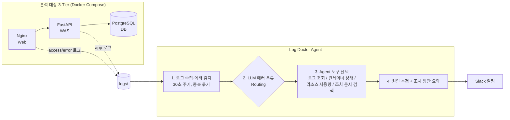

# Log Doctor — 서버 장애 로그 분석 Agent

> 서버 로그를 AI가 분석해 **장애 원인과 조치 방법을 Slack으로 알려주는** Workflow + AI Agent 하이브리드 시스템

대구대학교 Workflow / AI Agent 개발 과제 (개인 프로젝트, 마감 2026-12-04)

## 1. 프로젝트 소개

서버에 장애가 나면 담당자는 여러 로그 파일을 열어 원인을 찾아야 합니다. Log Doctor는 이 과정을 자동화합니다.

1. 로그에서 에러를 감지하고 (Workflow: 코드로 고정 처리)
2. LLM이 에러 유형을 분류한 뒤 (Routing)
3. Agent가 필요한 도구를 스스로 골라 추가 정보를 조사하고 (Tool Calling)
4. 원인 추정과 조치 방안을 Slack으로 보냅니다.

Agent는 **읽기 전용**입니다. 로그·상태를 조회해 원인을 분석하고 조치를 "제안"할 뿐, 서버를 직접 변경하지 않습니다.

## 2. 시스템 처리 흐름도



## 3. 사용 기술

| 영역 | 기술 | 선택 이유 |
|---|---|---|
| 분석 대상 인프라 | Docker Compose, Nginx, FastAPI, PostgreSQL | 무료, 로컬에서 장애를 재현하기 쉬움 |
| Agent 언어 | Python 3.12 | |
| Agent 프레임워크 | LangGraph (2주차~) | Routing·Tool Calling 흐름을 그래프로 명시 |
| LLM | Google Gemini API (2주차~) | 무료 티어 사용 |
| 알림 | Slack Incoming Webhook (2주차~) | 무료, 단방향 알림 |

## 4. 실행 방법

### 사전 준비
- Docker Desktop (Windows는 WSL2 기반 권장)
- Python 3.11 이상

### 3-Tier 환경 실행

```bash
git clone https://github.com/sorakaeri/log-doctor-agent.git
cd log-doctor-agent

# 환경 변수 파일 생성 후 비밀번호 수정
cp .env.example .env              # Windows PowerShell: Copy-Item .env.example .env

docker compose up -d --build
python scripts/chaos.py status
```

브라우저에서 http://localhost:8080/api/items 에 접속해 상품 목록이 보이면 정상입니다.

### 장애 시나리오 실행

| 명령 | 시나리오 | 로그에 남는 증상 |
|---|---|---|
| `python scripts/chaos.py traffic` | 정상 트래픽 | 200 응답 |
| `python scripts/chaos.py db-down` | DB 다운 | 앱 `DB 연결 실패`, Nginx 503 |
| `python scripts/chaos.py app-down` | WAS 다운 | Nginx upstream 연결 실패, 502 |
| `python scripts/chaos.py flood` | 요청 폭주 | Nginx `limiting requests`, 429 |
| `python scripts/chaos.py recover` | 전체 복구 | |

로그 위치: `logs/nginx/access.log`, `logs/nginx/error.log`, `logs/app/app.log`

## 5. 디렉터리 구조

```
log-doctor-agent/
├── docker-compose.yml   # 분석 대상 3-Tier
├── nginx/nginx.conf     # JSON access 로그, 요청 제한(429)
├── app/                 # FastAPI WAS (상품 API)
├── db/init.sql          # 초기 데이터
├── scripts/chaos.py     # 장애 시나리오 실행
├── logs/                # 각 계층 로그 (Git 제외)
└── docs/                # 실행 결과 스크린샷 등
```

## 6. 진행 현황

| 주차 | 내용 | 상태 |
|---|---|---|
| 1주차 (11/10~11/16) | 3-Tier 환경, 장애 시나리오 스크립트 | ✅ 코드 작성 |
| 2주차 (11/17~11/23) | 로그 수집·에러 감지, LLM 분류, Slack 전송 | ⬜ |
| 3주차 (11/24~11/30) | Agent 도구 연결, 조치 문서 RAG, 중복 알림 묶기 | ⬜ |
| 4주차 (12/1~12/3) | 테스트, 실행 결과, 문서 정리 | ⬜ |

## 7. 실행 결과

(4주차에 스크린샷과 시연 영상 추가 예정)

## 8. 참고 자료 및 AI 도구 활용

- 코드 초안 작성과 설계 검토에 Anthropic Claude를 활용했습니다.
- 참고한 유사 프로젝트: [HolmesGPT](https://github.com/HolmesGPT/holmesgpt) (오픈소스 AI SRE Agent), [AI Log Analysis with Ollama](https://www.virtua.cloud/learn/en/tutorials/ai-log-analysis-ollama-vps) (로그 → LLM → 알림 파이프라인)

## 보안

API 키, Slack Webhook URL, DB 비밀번호는 `.env`에만 저장하며 `.gitignore`로 Git에서 제외합니다.
